<p align="center">
  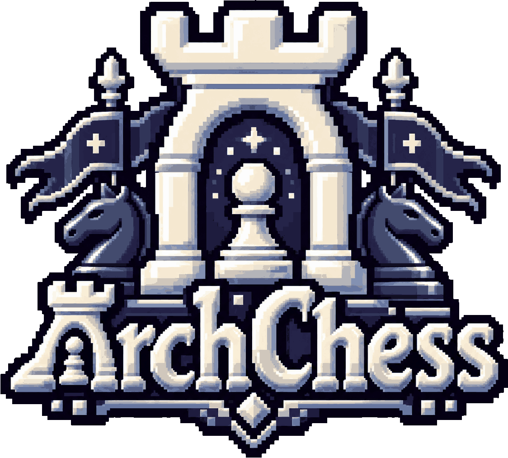
</p>

<h1 align="center">ArchChess</h1>

<p align="center">
  A chess room system: a Java backend that owns the rules, a pixel-art web frontend, a datalake that records every game, and an optional plugin system for chess engines.
</p>

---

## Contents

1. [Objective](#1-objective)
2. [Quick start](#2-quick-start)
3. [Requirements and dependencies](#3-requirements-and-dependencies)
4. [Build and run](#4-build-and-run)
5. [Docker](#5-docker)
6. [Plugins](#6-plugins)
7. [System architecture](#7-system-architecture)
8. [Backend: hexagonal architecture](#8-backend-hexagonal-architecture)
9. [Backend workflow: from request to new state](#9-backend-workflow-from-request-to-new-state)
10. [Datalake and persistence](#10-datalake-and-persistence)
11. [Communication contract](#11-communication-contract)
12. [Connecting users: rooms and invitations](#12-connecting-users-rooms-and-invitations)
13. [Data model](#13-data-model)
14. [Frontend: light hexagonal architecture](#14-frontend-light-hexagonal-architecture)
15. [Own contributions](#15-own-contributions)
16. [Screenshots](#16-screenshots)
17. [Verification](#17-verification)
18. [Known limits](#18-known-limits)
19. [Repository structure](#19-repository-structure)
20. [AI Usage](#20-ai-usage)

---

## 1. Objective

ArchChess is the individual project for *Ingeniería de Software 2* (ULPGC): a system for playing chess in **rooms** with a clear split between a frontend and a backend and explicit contracts between them.

What it does:

- Create a room, share a link and let a second player join; play against a plugin engine (PvCPU), watch two engines play each other (machine vs machine), or use a practice board.
- Validate every move on the **backend** with the full rules of chess (check, castling, en passant, promotion, mate, stalemate, draws).
- Record every game as events in a **datalake** so it can be queried later (history, replay).
- Offer accounts (SQLite) so the history belongs to a person; guests can play but have no history.
- Load chess engines as **plugins** (`.jar` files discovered at runtime), so the backend does not depend on any engine.

---

## 2. Quick start

```bash
# 1. Install the plugins library once (section 3), then build and write the classpath:
mvn -q -DskipTests package dependency:build-classpath -Dmdep.outputFile=target/classpath.txt
# 2. Run the backend (use ";" instead of ":" on Windows); it also serves the frontend:
java -cp "target/classes:$(cat target/classpath.txt)" reivajh06.archchess.Launcher
# 3. Open http://localhost:5000
```

Or with Docker, see [section 5](#5-docker).

---

## 3. Requirements and dependencies

| Requirement | Version | Notes |
| --- | --- | --- |
| JDK | **25** | `maven.compiler.source/target = 25`. The entry point uses Java 25's `static void main`. |
| Maven | 3.9+ | Any recent Maven works. |
| Node.js | 20+ | Optional: only for the frontend tests (`node --test`). |
| Docker | 24+ | Optional: only for the container. |

Main libraries (see [pom.xml](pom.xml)): Javalin 7.2.2 (HTTP + static files, Jetty inside), Gson 2.14.0 (JSON), sqlite-jdbc 3.53.4.0 (accounts), slf4j-simple, JUnit 5 for tests.

### The `archchess-plugins` library

The backend depends on a very small library, `archchess.reivajh06:archchess-plugins:1.0`, that defines the `Plugin` interface shared by the backend and the engine plugins. It is **not** on Maven Central and it is not committed here (the repository must not contain `.jar` files), so install it into your local Maven repository once:

```bash
mvn install:install-file \
  -Dfile=archchess-plugins-1.0.jar \
  -DpomFile=archchess-plugins-1.0.pom
```

Both files are vendored in the `lib/archchess/reivajh06/archchess-plugins/1.0/` folder of each plugin project (`archchess-stockfish-plugin`, `archchess-ollama-plugin`).

---

## 4. Build and run

### Build

```bash
mvn -DskipTests package        # compile + thin jar in target/
mvn test                       # 90 backend tests
```

### Run the backend (and the frontend: it is served by the backend)

The backend serves the web frontend from the classpath (`src/main/resources/web`), so **there is a single process and a single port**.

```bash
# From the IDE: run reivajh06.archchess.Launcher
# From the terminal:
mvn -q dependency:build-classpath -Dmdep.outputFile=target/classpath.txt
java -cp "target/classes:$(cat target/classpath.txt)" reivajh06.archchess.Launcher            # Linux / macOS
java -cp "target/classes;$(cat target/classpath.txt)" reivajh06.archchess.Launcher            # Windows (note the ;)
```

Open <http://localhost:5000>.

### Configuration

Defaults live in [`src/main/resources/archchess.properties`](src/main/resources/archchess.properties). To use another file, pass it as the first argument (it must exist and end in `.properties`):

```bash
java -cp ... reivajh06.archchess.Launcher /path/to/my.properties
```

| Property | Default | Meaning |
| --- | --- | --- |
| `server.port` | `5000` | HTTP port (API and frontend). |
| `home.path` | `temp` | Base folder. |
| `database.path` | `temp/archchess.db` | SQLite file with the accounts. |
| `datalake.path` | `temp/datalake` | Folder with the game events (JSONL). |
| `plugins.path` | `temp/plugins` | Folder scanned for plugin `.jar` files. |

All paths are relative to the working directory; `temp/` is git-ignored and created on start.

### Without plugins

Start it as above and leave `temp/plugins/` empty. Everything works except the machine modes: `GET /api/plugins` returns `{"plugins": []}` and the machine modes show "No plugins installed. Add one to the server to play this mode." Practice and PvP (two people through an invitation link) need no plugin.

### With plugins

Drop the plugin jars in the plugins folder (see [section 6](#6-plugins)). The backend scans the folder when it starts and **again every minute**, so jars added while it is running are picked up without a restart.

```text
temp/plugins/
├── stockfish.jar
└── ollama.jar
```

You can confirm they were loaded in the log (`Plugins loaded: [...]`) or at <http://localhost:5000/api/plugins>.

---

## 5. Docker

The image contains the backend and the frontend. It does not contain plugins: they are mounted as a volume, so you can add or change engines without rebuilding.

### Build the image

The Dockerfile copies the compiled classes and runtime dependencies, so compile first (this is also how the `archchess-plugins` library gets into the image):

```bash
mvn -DskipTests package dependency:copy-dependencies -DincludeScope=runtime
docker build -t archchess .
```

### Run it

```bash
docker run -d --name archchess \
  -p 5000:5000 \
  -v archchess-data:/data \
  archchess
```

Open <http://localhost:5000>. Everything that must survive the container lives in the `/data` volume (configured by [`docker/archchess.properties`](docker/archchess.properties)):

| Path in the container | Content |
| --- | --- |
| `/data/archchess.db` | SQLite accounts. |
| `/data/datalake/` | Game events (the history). |
| `/data/plugins/` | Plugin jars. |

### Plugin management in Docker

Plugins are just files in `/data/plugins`. Two ways to manage them:

```bash
# A) Bind-mount a host folder that contains the jars (read-only is enough)
docker run -d --name archchess -p 5000:5000 \
  -v archchess-data:/data \
  -v "$(pwd)/plugins:/data/plugins:ro" \
  archchess

# B) Copy jars into a running container; the backend rescans every minute
docker cp stockfish.jar archchess:/data/plugins/
docker cp ollama.jar    archchess:/data/plugins/
docker logs -f archchess      # look for: Plugins loaded: [...]
```

Engine specifics:

- **Stockfish.** The `stockfish.jar` plugin bundles a Windows Stockfish only, so inside this Linux container it needs a native one. Build the image with the bundled option, which installs the Debian `stockfish` package at `/usr/games/stockfish` (already set in `STOCKFISH_PATH`):

  ```bash
  docker build --build-arg INSTALL_STOCKFISH=true -t archchess .
  ```

  Without it, the plugin fails to start with *"No Stockfish bundled for this operating system. Set STOCKFISH_PATH"* (see [known limits](#18-known-limits)).
- **Ollama.** The container must reach your Ollama server; the plugin reads `OLLAMA_HOST` and `OLLAMA_MODEL`:

  ```bash
  docker run ... \
    -e OLLAMA_HOST=http://host.docker.internal:11434 \
    -e OLLAMA_MODEL=<your-model> \
    archchess
  ```

  On Linux add `--add-host=host.docker.internal:host-gateway`. If Ollama is not reachable, the plugin refuses to start and is skipped.

> What was checked: the image was built and run, the frontend and `/api/plugins` answered, a game was created and played, an account was created, and after `docker restart` the account and its history were still there (the in-progress game was not, see [known limits](#18-known-limits)). With `temp/plugins` mounted, both jars were discovered (`["Stockfish","Ollama"]`).

---

## 6. Plugins

Engines live outside the backend. The backend only knows the `Plugin` interface from `archchess-plugins`:

```java
public interface Plugin {
    String name();
    PluginType type();                       // e.g. AI or a regular engine
    void start();                            // heavy work goes here; throw to refuse to start
    boolean isReady();
    PluginResponse requestMove(String fen);
    PluginResponse requestMove(String fen, String legalMoves);   // AI plugins choose among the legal moves
    boolean sendParameters(PluginConfiguration configuration);   // difficulty + move time
}
```

`PluginsManager` (infrastructure adapter) discovers implementations with Java's **`ServiceLoader`** over a `URLClassLoader` that points to every jar in the plugins folder. For a jar to be found it must:

1. Contain `META-INF/services/reivajh06.plugins.Plugin` (in `src/main/resources` of the plugin) with the fully qualified name of the implementation. Without that file, `ServiceLoader` finds nothing.
2. Have a **public no-arg constructor** that is cheap (no processes or HTTP clients). Heavy initialization belongs in `start()`.
3. Not bundle its own copy of the `Plugin` interface in a different class loader: the host's `URLClassLoader` uses the backend's loader as parent so both sides share the same `Plugin` class.

Configuration is done with environment variables: `STOCKFISH_PATH` (Stockfish plugin), `OLLAMA_HOST` and `OLLAMA_MODEL` (Ollama plugin).

### Current plugins

Each plugin is its own project with its own repository, built independently (`mvn package`) and released as a single jar to drop into the plugins folder. Today there are three:

| Plugin | Repository | Jar | What it is | Configuration |
| --- | --- | --- | --- | --- |
| **Stockfish** | [archchess-stockfish-plugin](https://github.com/Reivajh06/archchess-stockfish-plugin) | `stockfish.jar` | Wraps the [Stockfish](https://stockfishchess.org/) engine. The jar is self-contained and bundles a Windows build (extracted to `<tmp>/archchess-stockfish/` on first start). GPLv3, because it redistributes Stockfish. | `STOCKFISH_PATH` or `-Dstockfish.path` for other operating systems (also overrides the bundled engine). Difficulty maps to Stockfish's Skill Level: EASY 1, MEDIUM 8, HARD 15, MAX 20. |
| **Ollama** | [archchess-ollama-plugin](https://github.com/Reivajh06/archchess-ollama-plugin) | `ollama.jar` | An **AI-type** plugin: asks a local LLM served by [Ollama](https://ollama.com) for its move. Obviously invalid answers are re-asked up to 4 times, but full legality is not checked by the plugin: the backend does that. | `OLLAMA_MODEL` (or first program argument / `-Dollama.model`; defaults to the first installed model) and `OLLAMA_HOST`. Difficulty maps to sampling temperature: EASY 1.2, MEDIUM 0.7, HARD 0.3, MAX 0. Reports "Local llm not installed" if Ollama or its models are missing. |
| **Archon** | [archon-engine](https://github.com/Reivajh06/archon-engine) | `archon.jar` | A pure-Java chess engine written for Archchess: no external engine needed, so it runs the same on any operating system (including the Docker image). | EASY (depth 2, randomized within 180 cp), MEDIUM (depth 5, randomized within 25 cp), HARD (depth 9, best move), MAX (time-limited, best move). Default budget 1000 ms; the backend sends 50 ms. |

All three also speak a small line protocol over stdin/stdout when run with `java -jar` (`name`, `move <FEN>`, `config <level> [ms]`, `exit`; replies are prefixed with `$archchess:`), which is handy for testing a plugin without the backend. In the app they are listed by `GET /api/plugins` (by the name each plugin reports) and chosen in the "Play a machine" / "Machine vs machine" menus.

> **Archon is the easiest plugin to try in Docker**, since it needs no native executable: copy `archon.jar` into `/data/plugins`. (Stockfish and Ollama were checked in the container; Archon was not tried there.) Stockfish needs a Linux binary in the container (see [Docker](#5-docker)) and Ollama needs a reachable Ollama server.

---

## 7. System architecture

Two applications and a datastore, coordinated by an explicit HTTP + JSON contract ([section 11](#11-communication-contract)). The frontend never touches the datastore; the backend never touches the DOM.

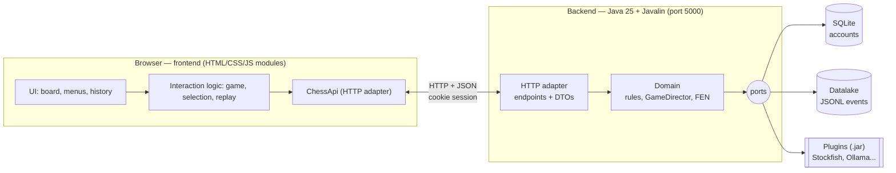

| Piece | Technology | Responsibility |
| --- | --- | --- |
| Frontend | Vanilla JS modules, HTML, CSS (served by the backend) | Drawing the board, collecting the user's intent, showing the state the backend returns. **It does not decide whether a move is legal.** |
| Backend | Java 25, Javalin | Rooms, rules, turn order, game state, history, plugin calls. **Single source of truth** for the game. |
| SQLite | `temp/archchess.db` | Accounts (username + SHA-256 password hash). |
| Datalake | JSONL files in `temp/datalake/` | Append-only record of everything that happens (sessions, moves, promotions...). |
| Plugins | `.jar` via `ServiceLoader` | Chess engines that answer "what move would you play for this FEN?". |

**Who is responsible for what**

| Concern | Frontend | Backend |
| --- | --- | --- |
| Which moves are legal for a piece | Asks (`legal-moves`) and highlights what it is told | **Computes and enforces it** |
| Turn order | Shows whose turn it is | **Enforces it** (`403` if it is not your turn) |
| Check, mate, draws, game status | Displays them | **Computes them** |
| Engine moves | Asks for one (`request-move`) and animates the result | Calls the plugin, validates its answer, applies it |
| Move history | Renders it / replays it | Records it (datalake) and serves it (`/api/history`) |
| Accounts | Forms | Validation, hashing, storage |
| Themes, sounds, animations, Alfi | **Everything** | Nothing |

---

## 8. Backend: hexagonal architecture

The domain (rules of chess) sits in the centre. It does not know about HTTP, JSON, SQLite or files. Everything that talks to the outside world is an **adapter** in the `infrastructure` package, and the domain declares what it needs through **ports**.

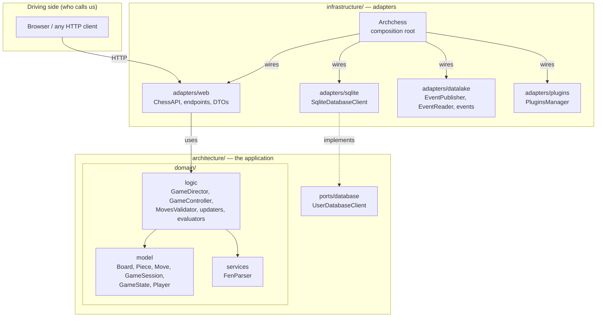

### Packages and classes

| Package (`reivajh06.archchess...`) | Role | Main classes |
| --- | --- | --- |
| `architecture.domain.model` | Chess vocabulary and state. Pure data and rules, no I/O. | `Board`, `Tile`, `Piece`, `PieceFactory`, `Player` |
| `architecture.domain.model.movement` | How pieces move, declared as data. | `Move`, `MoveRules`, `MoveCondition`, `MoveEffect`, `MoveEvent` |
| `architecture.domain.model.game` | The game itself. | `GameSession`, `GameState`, `GameStateBuilder`, `GameConditions`, `GameStatus`, `Gamemode`, `Difficulty` |
| `architecture.domain.logic` | Use-case logic: compute moves, apply a move, update the state. | `GameDirector`, `GameController`, `MovesValidator` |
| `architecture.domain.logic.updaters` | One class per state field that a move changes. | `TurnColorUpdater`, `CastlingRightsUpdater`, `EnPassantUpdater`, ... |
| `architecture.domain.logic.evaluators` | One class per conclusion drawn from the new state. | `CheckedColorEvaluator`, `GameStatusEvaluator`, ... |
| `architecture.domain.services` | FEN reading and writing. | `FenParser` |
| `architecture.ports.database` | **Output port** defined by the application. | `UserDatabaseClient` |
| `infrastructure.adapters.web` | **Input adapter**: HTTP routes, JSON DTOs, error mapping. | `ChessAPI`, `endpoints/*`, `dtos/*`, `ApiException` |
| `infrastructure.adapters.sqlite` | **Output adapter** implementing `UserDatabaseClient`. | `SqliteDatabaseClient`, `queries/*`, `ShaEncoder` |
| `infrastructure.adapters.datalake` | **Output adapter**: event store (write and read). | `EventPublisher`, `EventReader`, `events/*` |
| `infrastructure.adapters.plugins` | **Output adapter**: loads engines. | `PluginsManager` |
| `infrastructure` | Composition root. | `Archchess`, `Configuration` |

### How the hexagon is applied here (and its honest limits)

- **Domain in the centre, framework outside.** `architecture/` has no import of Javalin, Gson or JDBC. The HTTP framework only appears in `infrastructure.adapters.web`; the endpoints are written against an `EndpointContext` interface (implemented by `JavalinEndpointContext`), so the use-case code does not see Javalin types.
- **Output port with a swappable adapter.** Persistence of accounts is hidden behind `UserDatabaseClient`; `SqliteDatabaseClient` is just one implementation. `Archchess` is the only place that decides which one is used.
- **Use cases.** The use-case logic is the `GameDirector` family in `domain/logic`. Each endpoint class (`PostMovePiece`, `PostLegalMoves`...) is a thin use-case entry that parses the request, calls the domain and publishes an event. There are deliberately **no per-use-case input interfaces**: for a project of this size they would only add classes.
- **Not fully by the book.** The datalake and the plugin loader are adapters, but they do not yet have an interface in `architecture/ports`; the endpoints reach them through the `Archchess` composition root. Introducing `EventStorePort` and `EnginePort` there is the next step if the project grows, and would not change the domain.

### Demonstrating an adapter swap without touching the use case

`UserDatabaseClient` is the seam. A test double only needs to implement five methods:

```java
class InMemoryUsers implements UserDatabaseClient {
    private final Set<String> usernames = new HashSet<>();
    public void init() {}
    public boolean usernameExists(String u) { return usernames.contains(u); }
    public boolean playerExists(Player p)   { return usernames.contains(p.username()); }
    public void registerPlayer(Player p)    { usernames.add(p.username()); }
    public void deletePlayer(Player p)      { usernames.remove(p.username()); }
}
```

Nothing in `architecture/` changes when SQLite is replaced by this class.

---

## 9. Backend workflow: from request to new state

### Responsibilities of the backend classes

| Class | Responsibility | It does **not** |
| --- | --- | --- |
| `Piece` / `PieceFactory` | Knows its moveset: a list of `Move(x, y, repetitions, condition, effect)` | know the board |
| `GameController` | Geometry and board mechanics: tiles a move reaches, apply/undo a move, legal-move filtering | change the game state |
| `MovesValidator` | Applies each move's `MoveCondition` to a list of candidate tiles | apply moves |
| `GameConditions` | Questions about a position: is the king checked, checkmate, stalemate, dead position, repetition | change anything (it applies and undoes moves on the board only to test) |
| `GameDirector` | Orchestrates: asks for legal moves, applies a move, runs the updaters and evaluators, promotes | know HTTP |
| `Updater`s | Compute the *new* value of one field of the state | read other updaters' results |
| `Evaluator`s | Derive conclusions from the transitional state (check, history, repetitions, status) | modify the board |
| `FenParser` | Convert board/state to and from FEN | know the game flow |
| Endpoints | HTTP parsing, identity, turn check, calling the director, publishing events | contain chess rules |

### 9.1 Defining and filtering piece moves

Each piece's moves are **data**. A `Move` says "go `x` files and `y` ranks, up to `repetitions` times" and carries two behaviours: a `MoveCondition` (when is it allowed) and a `MoveEffect` (what it does to the board: plain move, capture, en passant, castling). For example, a pawn has separate moves for one step, two steps, two diagonal captures and en passant; that is why the legal-moves answer is grouped by `moveId`.

Legal moves are computed in successive filters:

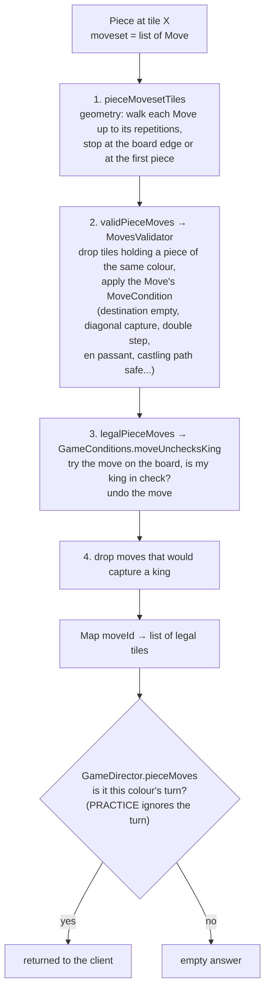

When a move is **played**, the backend validates it against that same pipeline and does not trust the client:

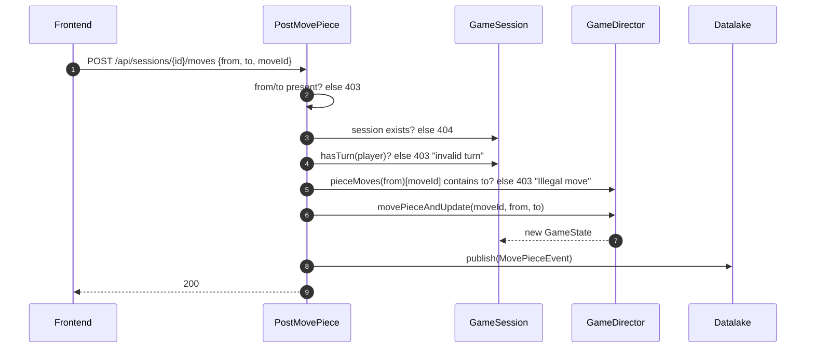

### 9.2 Game state updates

`GameState` is an immutable record: board, moves history, captured pieces, turn colour, checked colour, status, castling rights, en passant target, half-move clock, full moves and a map of repeated positions. `GameDirector.movePieceAndUpdate` never edits it in place; it builds a **new** state in two phases:

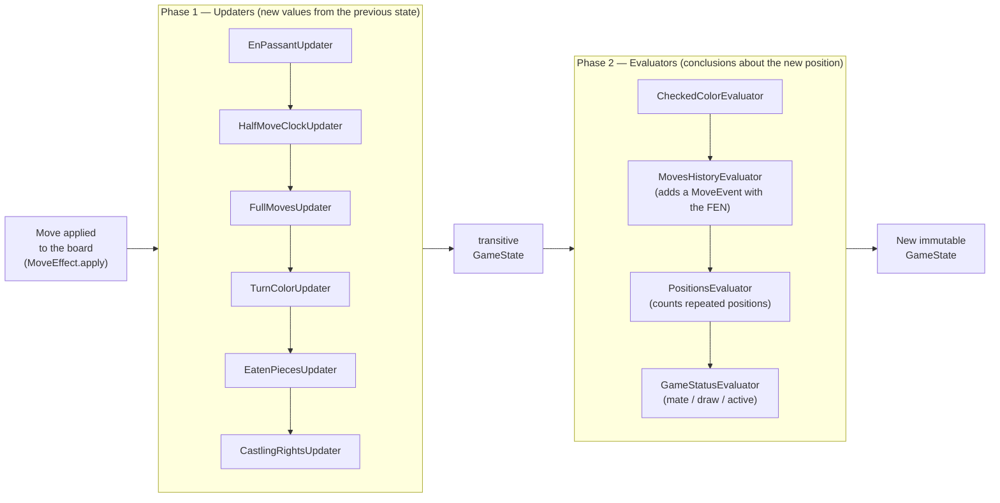

Why two phases: the evaluators need the *already updated* turn, castling rights and clocks to answer questions such as "is that king in check?" or "is that position repeated?". Each updater and evaluator is a class with a single method, so adding a rule means adding a class to the list in `GameDirector`.

**What `GameStatusEvaluator` decides**

| Result | Condition |
| --- | --- |
| `WHITE_WIN` / `BLACK_WIN` | The opponent's king is in check and no piece has a legal move |
| `DRAW` | Stalemate, dead position (K vs K, K+B vs K, K+N vs K, K+B vs K+B on the same colour), five-fold repetition, or the full-move threshold (75) |
| `ACTIVE` | Anything else |

Promotion is a separate step (`POST .../promote` → `GameDirector.promotePiece`): it replaces the pawn on the last rank, then re-evaluates check and checkmate.

### 9.3 FEN management

FEN is the language between the backend, the datalake and the plugins. `FenParser` is the only class that reads or writes it.

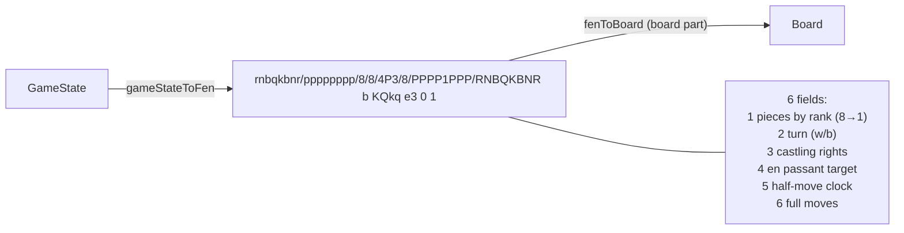

Where FEN is used:

| Use | Where |
| --- | --- |
| Ask an engine for a move | `GetRequestMove` sends `session.toFEN()` to the plugin |
| Record every move | `MovePieceEvent.stateFen` in the datalake, and every `MoveEvent` in the in-memory history |
| Detect repetition | `PositionsEvaluator` counts `Position(fen)` occurrences |
| Return the state to the client | `GET /api/sessions/{id}` → `fen` |
| Replay a registered game | Each historical move carries its resulting FEN |

### 9.4 Machine moves (plugins)

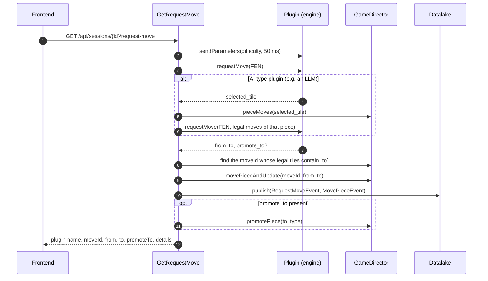

A plugin never moves a piece itself: it proposes, and the move is applied through the same domain code as a human's. For LLM-style plugins the backend narrows the choice to the legal moves of the selected piece.

---

## 10. Datalake and persistence

Persistence has two stores with different jobs:

| Store | Technology | Holds | Why |
| --- | --- | --- | --- |
| **Database** | SQLite behind `UserDatabaseClient` | Accounts (`PLAYERS`) | Small relational data that is looked up by key |
| **Datalake** | Append-only JSONL files | Everything that happens in a game | History is a stream of facts; it is written once and read later |

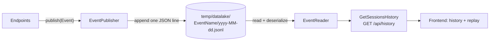

### Layout

One folder per event type, one file per day:

```text
temp/datalake/
├── CreateSessionEvent/2026-11-11.jsonl
├── JoinSessionEvent/2026-11-11.jsonl
├── MovePieceEvent/2026-11-11.jsonl
├── PromotePieceEvent/...
├── RequestMoveEvent/...
├── DeleteSessionEvent/...
├── CreateAccountEvent/  LoginEvent/  LogoutEvent/  DeleteAccountEvent/
```

Every event carries `id`, `timestamp` and `username`; each type adds its own fields. A move looks like this (one line in the file):

```json
{"sessionId":"2bfc8d4f-…","moveId":1,"from":"e2","to":"e4","pieceType":"PAWN",
 "stateFen":"rnbqkbnr/pppppppp/8/8/4P3/8/PPPP1PPP/RNBQKBNR b KQkq e3 0 1","status":"ACTIVE",
 "timestamp":"2026-11-11T20:55:21.361","id":"…","username":"smokeuser"}
```

### How the history is rebuilt

`GetSessionsHistory` is a read model over the events:

1. Take the `JoinSessionEvent`s of the player to know which rooms they joined.
2. Take the `CreateSessionEvent`s created by them or joined by them.
3. For each room, take its `MovePieceEvent`s ordered by timestamp, attach the `PromotePieceEvent` that happened between that move and the next one, and number the plies.
4. The status of the game is the status of the last move; the rival is the other user in the `JoinSessionEvent`.

The result is what the frontend shows in the history screen and replays (`ply`, `piece`, `from`, `to`, `promotion`, resulting `fen`, `status`, `timestamp`).

### Why a datalake

- **Append-only** writes are trivial and cannot corrupt earlier records.
- The same events can feed other readers later (statistics, an analysis tool, a different database) without changing the endpoints that produce them.
- Nothing in the domain knows the datalake exists; endpoints publish events *about* what the domain did.

---

## 11. Communication contract

HTTP + JSON. Squares are lowercase algebraic strings (`"e2"`) in requests; colours are `WHITE`/`BLACK`; statuses are `ACTIVE`, `WHITE_WIN`, `BLACK_WIN`, `DRAW`; game modes are `PRACTICE`, `PVP`, `PVM` (player vs machine) and `MVM` (machine vs machine). The player is identified by the **HTTP session cookie** (a guest becomes a registered player after `login`).

The complete frontend-facing description (every body, field and the frontend's behaviour per status) is in [`src/main/resources/FRONTEND_API_CONTRACT.md`](src/main/resources/FRONTEND_API_CONTRACT.md). Summary:

| Method | Route | Purpose |
| --- | --- | --- |
| `POST` | `/api/sessions` | Create a room (`gamemode`, `difficulty`, `pluginNames`); returns the id, your colour and the state |
| `GET` | `/api/sessions/{id}` | Read the current state (also used to spectate) |
| `POST` | `/api/sessions/{id}/join` | Take the free seat |
| `POST` | `/api/sessions/{id}/legal-moves` | Legal moves of one piece, grouped by `moveId` |
| `POST` | `/api/sessions/{id}/moves` | Play a move `{from, to, moveId}` |
| `POST` | `/api/sessions/{id}/promote` | Promote a pawn |
| `GET` | `/api/sessions/{id}/request-move` | Ask the seat's plugin to play |
| `DELETE` | `/api/sessions/{id}` | Leave the game |
| `GET` | `/api/history` | Recorded games of the logged-in player |
| `GET` | `/api/plugins` | Names of the loaded plugins |
| `GET` | `/api/server` | Server LAN address (for invitation links) |
| `POST` | `/api/accounts`, `/api/login`, `/api/logout` | Account lifecycle |
| `DELETE` | `/api/accounts/delete` | Delete the account |

### Errors

Every failure is a JSON body `{ "error": "<STATUS>", "message": "<text>" }` produced by `EndpointHandler`:

| Status | When |
| --- | --- |
| `400 BAD_REQUEST` | Invalid username/password on sign-up, plugin error, unexpected exception |
| `403 FORBIDDEN` | Illegal move, move out of turn, incomplete request (missing `from`/`to`), guest asking for history, not your game |
| `404 NOT_FOUND` | Session does not exist, wrong login |
| `409 CONFLICT` | Room already full, account already exists |

Real responses captured from a running instance:

```text
POST /api/sessions/{id}/moves   {"from":"e2","to":"e5","moveId":0}
→ 403 {"error":"FORBIDDEN","message":"Illegal move"}

GET  /api/sessions/11111111-1111-1111-1111-111111111111
→ 404 {"error":"NOT_FOUND","message":"Session not found"}

GET  /api/history   (as a guest)
→ 403 {"error":"FORBIDDEN","message":"Player not registered"}

POST /api/accounts  {"username":"ab","password":"x"}
→ 400 {"error":"BAD_REQUEST","message":"Invalid username/password"}

POST /api/sessions/{id}/legal-moves  {"from":"e2"}
→ 200 {"moves":[{"moveId":0,"tiles":[{"rank":"R3","file":"E"}]},
                {"moveId":1,"tiles":[{"rank":"R4","file":"E"}]},
                {"moveId":2,"tiles":[]}, ... ]}
```

---

## 12. Connecting users: rooms and invitations

The mechanism is a **room with a shareable link**:

1. Player A creates a room (`POST /api/sessions`). The response carries the `sessionId` and A's colour (random).
2. The frontend builds an invitation: `http://<server-address>:5000/?session=<sessionId>`. The "Invite" dialog gets the server's LAN address from `GET /api/server` so the link also works from another device on the same network.
3. Player B opens the link; the frontend calls `POST /api/sessions/{id}/join`. The backend gives B the remaining colour (`409` if the room is full, `404` if it does not exist).
4. Both clients read the state of the room (`GET /api/sessions/{id}`, with a polling loop) and send moves to the same session. The backend decides whose turn it is from the identity of each player.
5. **Spectator link:** `/?watch=<sessionId>` opens the same room read-only; a watcher never sends moves.

For machine modes, the machine's seat is occupied by a `Player` named after the plugin (`<plugin>#<session>`), and the frontend asks for its move with `request-move` when it is its turn.

---

## 13. Data model

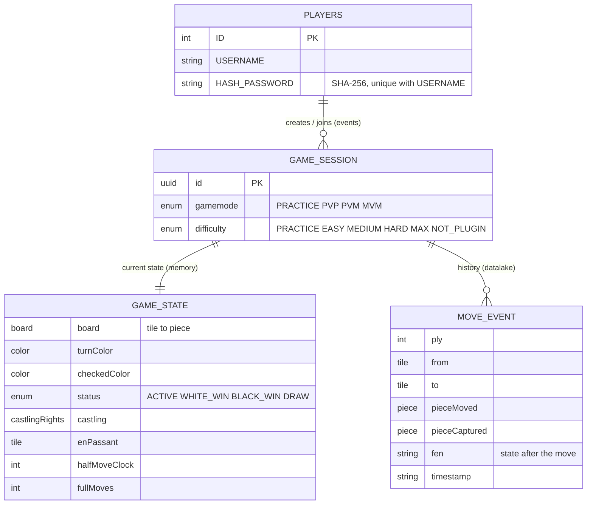

| Concept | Where it lives | Notes |
| --- | --- | --- |
| **User** | `PLAYERS` table (SQLite) + `Player` record | Registered users have an account; guests are `guest#<http session id>`; engines are `<plugin>#<session id>` |
| **Room / game** | `GameSession` (memory) + `CreateSessionEvent` / `JoinSessionEvent` (datalake) | The live game is in memory; its trace is persistent |
| **Move** | `MoveEvent` (memory) + `MovePieceEvent` (datalake) | Each carries the resulting FEN |
| **Game state** | `GameState` (memory) | Immutable record, rebuilt after each move |
| **Result** | `GameStatus` | Stored with every move event; the last one is the game's result |

Account rules: username 3–20 characters (`a-z A-Z 0-9 _ -`), password at least 8 characters with a letter and a digit, and the username must not contain the password. Passwords are stored as SHA-256 hashes (see [known limits](#18-known-limits)).

---

## 14. Frontend: light hexagonal architecture

The frontend (`src/main/resources/web`) is plain ES modules without a build step. The separation is lighter than the backend's, but the roles are the same:

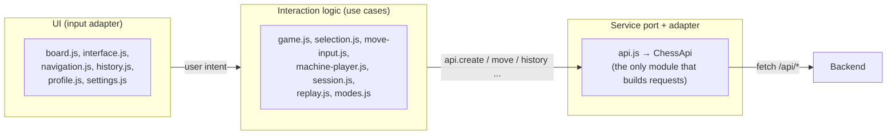

| Role | Modules |
| --- | --- |
| UI (draws, listens to clicks) | `board.js`, `interface.js`, `navigation.js`, `history.js`, `profile.js`, `settings.js`, `ui.js` |
| Interaction use cases | `game.js` (`createGame({ api, ... })`), `selection.js`, `move-input.js`, `machine-player.js`, `session.js` (`SessionAccess`, `SessionPolling`), `replay.js` |
| Service port and HTTP adapter | `api.js` (`ChessApi`): paths, JSON bodies, timeouts, error mapping and the translation between the backend's mode names (`PVM`/`MVM`) and the page's own |
| Pure presentation | themes, sounds, music, Alfi (`alfi-*.js`, `mascot.js`, `themes.js`, `audio.js`, `music.js`) |

Network calls to the backend are made only in `api.js` (the only other `fetch` loads a theme asset); the interaction modules receive an `api` object (`createGame({ api, ... })`) and use its methods. **That object is the seam**: the adapter can be replaced by any object with the same methods, and the frontend tests do exactly that (`src/test/frontend/*.test.mjs`).

Honest note: `ChessApi` is a concrete class rather than an explicit interface, as JavaScript has none; the contract is the set of its methods, checked by `api-contract.test.mjs`.

---

## 15. Own contributions

1. **Engines as plugins.** The backend has no chess engine; it loads engines from jars at runtime with `ServiceLoader`, re-scanning every minute. Stockfish, a local LLM (Ollama) and a pure-Java engine (Archon) exist as plugins, with difficulty levels that the backend passes through `PluginConfiguration`. *Why it fits:* it keeps the domain independent of any engine (the backend validates whatever the plugin proposes), shows the output-port idea applied to a real extension point, and the assignment does not require an AI, so it is optional and the system works without it.
2. **Datalake as the history.** Instead of a game table, every fact is appended as an event and the history is a read model over those events. *Why it fits:* the record is traceable and reproducible, and the writer does not care who reads it.
3. **Alfi, an optional sarcastic opponent and mascot,** and a themeable pixel-art interface (ten board/piece themes, sounds, music). It lives only in the frontend and can be switched off; the game works the same without it. *Why it fits:* it is an experience improvement that does not touch the backend contract.
4. **Invitation links with a spectator mode** on top of the room mechanism.

---

## 16. Screenshots

Captured from the running app (frontend served by the backend on a local instance). The two players in the room and history captures are demo accounts created only for these images.

### Title screen and Alfi

The mode menu: play a person, practice, play a machine, machine vs machine, join a game. Alfi, the bishop mascot, comments from the corner (he can be switched off in the settings).

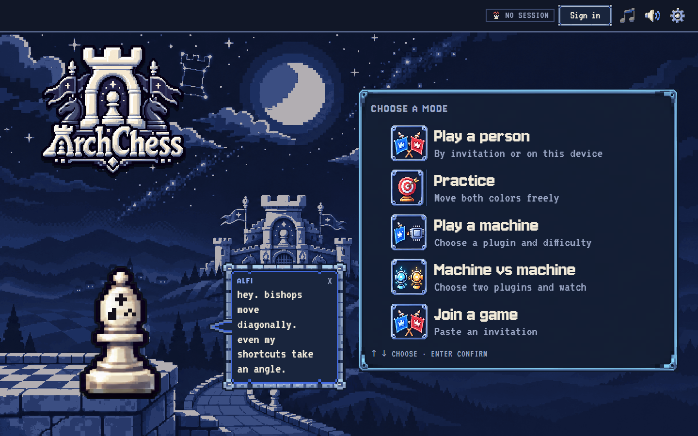

### Board

A practice board (both colours can be moved freely), with the turn indicator, material balance, Alfi's commentary and the move list on the right.

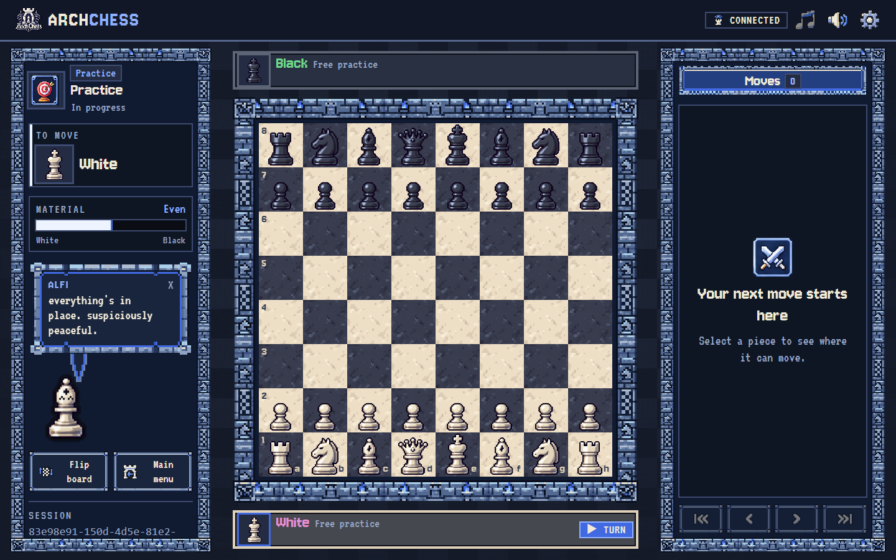

### A room and its invitation

Creating a "Play a person" room opens the invitation dialog; the link carries the room's `sessionId`. (The host part of the link is shown as `localhost` in this capture; the app normally shows the machine's LAN address.)

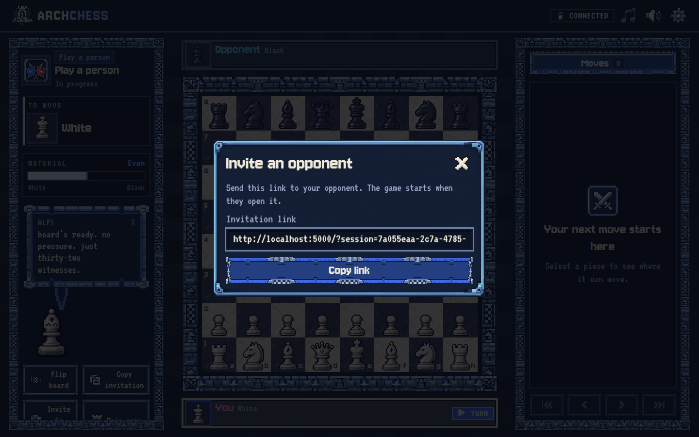

### A game in progress, seen by a spectator

The same room opened through a spectator link (`/?watch=<sessionId>`): ten moves already played by two different users, shown read-only with the full move list.

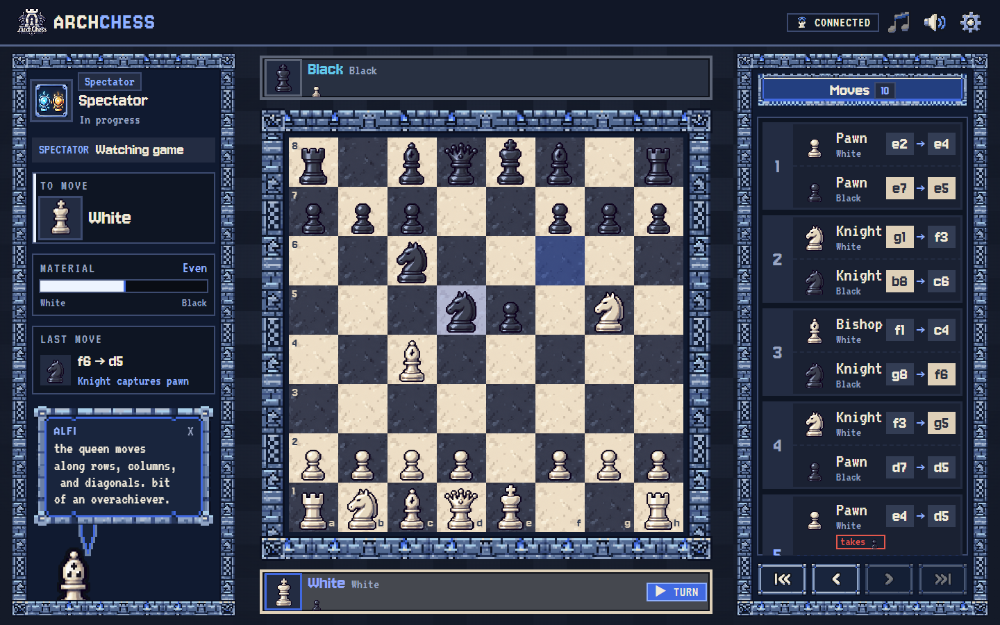

### Recorded game: history and replay

The profile screen lists the games rebuilt from the datalake (`GET /api/history`), and any of them can be replayed move by move.

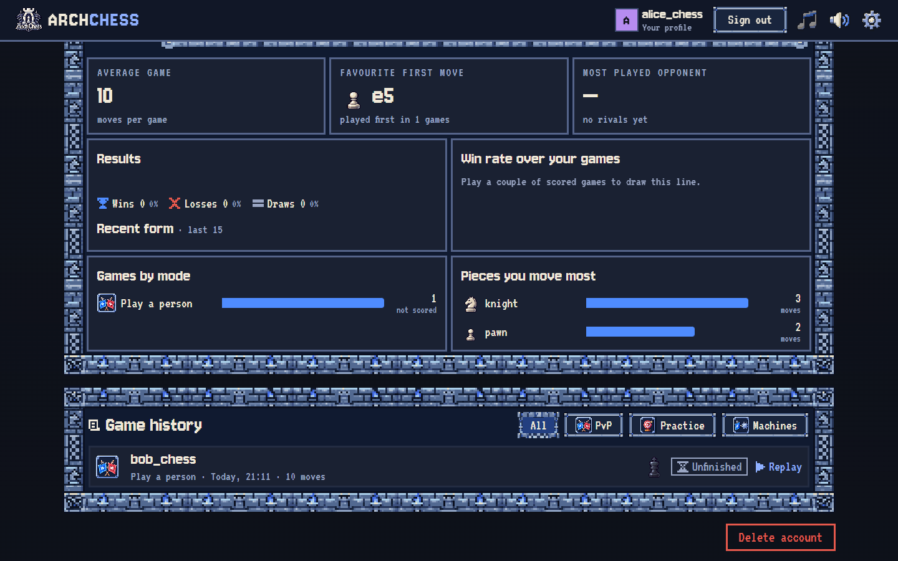

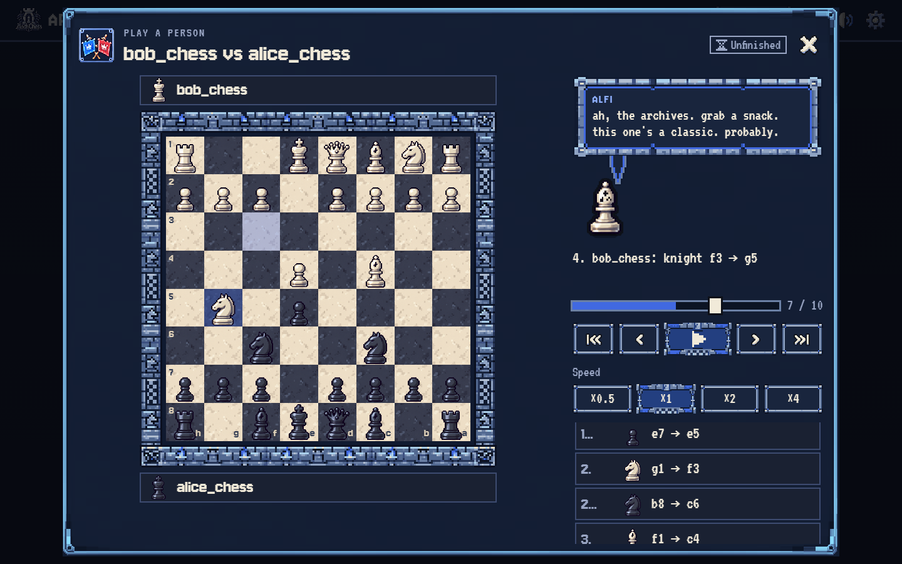

---

## 17. Verification

### Automated

```bash
mvn test                                      # backend
node --test src/test/frontend/*.test.mjs      # frontend
```

| Suite | Count | Covers |
| --- | --- | --- |
| `ChessRulesTest`, `MoveValidationTest` | 27 | Piece movement, move conditions, illegal moves |
| `GameDirectorCastlingTest` | 12 | Castling rules and rights |
| `GameSimulationTest` | 37 | Full games: mates, stalemate, draws, en passant, promotion |
| `FenParserTest` | 5 | FEN generation and parsing |
| `ChessTestSupportTest` | 9 | Test helpers |
| **Backend total** | **90** | **All passing** (`BUILD SUCCESS`, run 2026-11-11) |
| Frontend (`src/test/frontend`) | 140 | **137 passing, 3 failing** (run 2026-11-11) |

The 3 failing frontend checks are in `machine-turns.test.mjs`: they still expect the old mode name `AIVAI` in the creation request, while `api.js` now sends the backend's `MVM`. It is a stale test expectation, not a runtime failure, and it is pending an update.

### Manual checks (documented)

Run against the Docker image on 2026-11-11:

| Check | Result |
| --- | --- |
| Start from a clean image, open `/` | `200`, frontend served |
| `GET /api/plugins` without plugins | `{"plugins": []}` |
| `GET /api/plugins` with `temp/plugins` mounted | `["Stockfish","Ollama"]` |
| Create a room, read legal moves of `e2` | Single and double step offered (`moveId` 0 and 1) |
| Illegal move `e2→e5` | `403 Illegal move` |
| Unknown session | `404 Session not found` |
| Incomplete/invalid account | `400 Invalid username/password` |
| Guest asks for history | `403 Player not registered` |
| Sign up, play `e2→e4`, read `/api/history` | One game with `ply 1`, piece, squares, FEN, status |
| `docker restart`, log in again, `/api/history` | Same game still returned (datalake persisted) |
| `docker restart`, read the live game | `404` (live games are in memory, see limits) |

Two users on one room: open the invitation link in a second browser (or a private window, which has its own cookie); both see the same board and the backend enforces whose turn it is.

---

## 18. Known limits

- **Live games are not persisted.** `GameSession`s are in an in-memory map, so after a backend restart an in-progress game returns `404`. What *is* persisted is the datalake history and the accounts; recorded games can still be queried and replayed. Rebuilding a live session by replaying its events is possible but not implemented.
- **Rules.** Implemented: all piece movement, check, checkmate, stalemate, castling (with rights and safe path), en passant, promotion, dead position, five-fold repetition and a draw once the game reaches 75 full moves (a simplification: FIDE's 75-move rule counts moves without a capture or pawn move). Not implemented: draw by agreement, resignation as a game result, the fifty-move rule on demand, clocks.
- **Practice mode** ignores the turn when listing legal moves.
- **Concurrency.** One JVM; sessions use a concurrent map and the datalake publisher is synchronized, but `GameDirector` has no per-session lock: two simultaneous moves in the same room are not serialized. Clients poll (`GET /api/sessions/{id}`) instead of receiving pushes; there is no WebSocket yet.
- **Identity.** Players are identified by the HTTP session cookie; the cookie is lost on restart, so logged-in users must sign in again. Guests are `guest#<session id>`.
- **Passwords** are hashed with plain SHA-256 (no salt, no key stretching). Acceptable for a course project, not for production.
- **Malformed JSON** bodies produce a generic `400` rather than a detailed message.
- **Plugin loader.** A plugin whose `start()` throws a runtime exception other than `PluginException` (for instance Stockfish on an OS without a bundled engine and no `STOCKFISH_PATH`) terminates the `plugins-reloader` thread: the other plugins stay registered but the one-minute rescan stops until the next restart. It also re-calls `start()` on every loaded plugin at each rescan.
- **Frontend tests:** 3 stale expectations, see [section 17](#17-verification).
- **Build:** the `archchess-plugins` library must be installed in the local Maven repository first ([section 3](#3-requirements-and-dependencies)).

---

## 19. Repository structure

```text
chess-software/
├── pom.xml
├── Dockerfile                       # backend + frontend image
├── docker/archchess.properties      # configuration used inside the image
├── docs/screenshots/                # required captures
├── src/
│   ├── main/
│   │   ├── java/reivajh06/archchess/
│   │   │   ├── Launcher.java                    # entry point
│   │   │   ├── architecture/
│   │   │   │   ├── domain/{model,logic,services}
│   │   │   │   └── ports/database
│   │   │   └── infrastructure/
│   │   │       ├── Archchess.java, Configuration.java
│   │   │       └── adapters/{web,sqlite,datalake,plugins}
│   │   └── resources/
│   │       ├── archchess.properties
│   │       ├── FRONTEND_API_CONTRACT.md
│   │       └── web/                             # frontend (index.html, app.js, modules/, css/, assets/)
│   └── test/
│       ├── java/                                # backend tests
│       └── frontend/                            # frontend tests (node --test)
└── README.md
```

Main classes to read first: `GameDirector` (orchestration), `GameController` and `MovesValidator` (move filtering), `GameConditions` (check/mate/draw), `FenParser`, `PostMovePiece` (a complete use case), `Archchess` (composition root) and `PluginsManager`.

---

## 20. AI Usage

This section is deliberately plain about who did what.

**Tools:** Claude (Claude Code, as a mentoring assistant) and Codex (OpenAI's coding agent, run through its CLI).

**The backend was designed and written by me.** That includes the domain model and the move/state design (moves as data with conditions and effects, updaters and evaluators, `GameDirector`), FEN handling, the datalake and event model, the session and identity handling, the SQLite adapter, the plugin architecture and `ServiceLoader`-based loader, and the package layout of the hexagon. I also made the architectural decisions: what stays in memory, what is persisted, where the ports go, and which parts of the hexagonal ideal to leave out to keep the project small. Claude acted as a mentor for the backend: it asked questions, challenged design choices and pointed at problems when I was stuck, but I wrote the backend code myself.

**Claude and Codex were used for the frontend, the images, the tests and the documentation.**

- *Frontend:* the web interface (layout, pixel-art styling, board rendering, menus, themes, sounds, the Alfi mascot, interaction modules) was built mainly with Claude and Codex under my direction: I decided what the screens and behaviours should be, reviewed the results, and asked for changes.
- *Tests:* the backend tests (`src/test/java`) and the frontend tests (`src/test/frontend`) were written by Claude. They check the backend I wrote, and they are not a substitute for its design: any flaw they do not cover is a flaw of my implementation.
- *Images:* the logo and the pixel-art assets (`assets/`, `assets/castle/`) were created with AI assistance. Fonts are Pixelify Sans and Silkscreen (SIL OFL licenses included in `assets/`).
- *Documentation:* this README and `src/main/resources/FRONTEND_API_CONTRACT.md` were written by Claude from the code, the assignment document and a set of manual checks run against the Docker image. The diagrams are Mermaid source in this file.
- *Plugins (Stockfish, Ollama, Archon):* these three projects were **vibe-coded** with AI. That is deliberate: the plugins are out of the scope of the assignment. Choosing a plugin architecture was my own decision, to add flavor to the project, and my effort went into the backend that hosts them: the `ServiceLoader`-based `PluginsManager`, and validating every move a plugin proposes with the same domain code as a human's move. What is inside each engine is not part of what I am presenting as my work, and the system works without any of them.
- *Docker support:* the `Dockerfile` and the Docker section were written with Claude and tested by building and running the image.

**Things to keep in mind when reading the project:** the frontend is the part largely produced with AI, so its architecture description in section 14 documents what the code does rather than a design I wrote by hand. The backend is the part that represents my own engineering work and is the one the architecture sections describe in depth.
